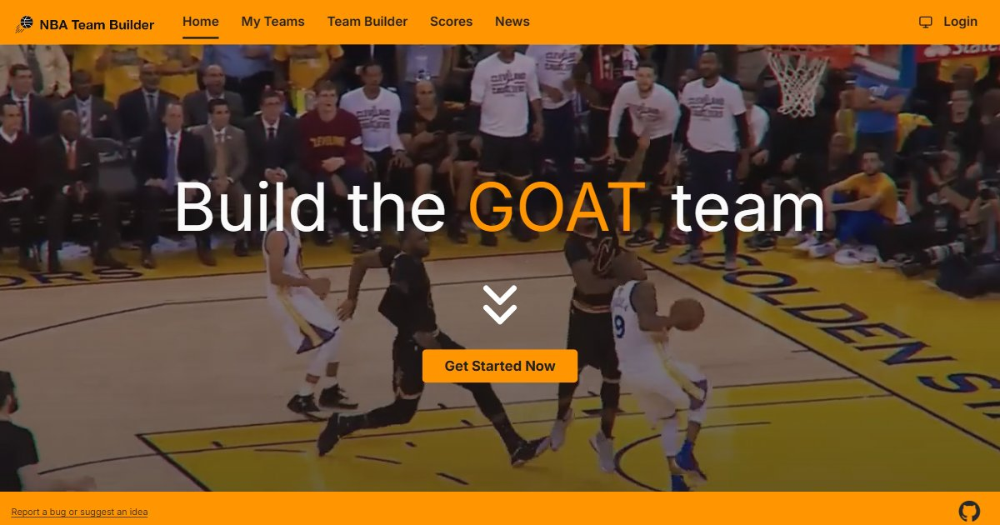

# nba-central

Draft your own NBA team from every player in league history, then give it a
coach, a GM, and an arena.

**Try it: [nba.yusufaf.dev](https://nba.yusufaf.dev)**



## Features

- **Team Builder**: a starting five and bench from the full all-time player
  pool, with career stats, 2K ratings, and side-by-side player comparison.
  Real or custom coaches, GMs, and arenas.
- **Share**: publish a team to get a public link that unfurls with a rendered
  team card.
- **Scores and news**: the day's games, full box scores, and an NBA news feed.

Building a team works signed out. Sign in to save and publish teams and to
sync settings across devices.

Fan-made project. Not affiliated with or endorsed by the NBA.

## Development

### Stack

- **apps/web**: Vue 3 + Vite + TypeScript, Pinia, Tailwind v4, shadcn-vue
- **apps/cdk**: AWS CDK (TypeScript): API Gateway, Lambda, DynamoDB, S3, CloudFront

pnpm workspace, one lockfile. Each package versions and deploys independently.

### Quickstart

```bash
pnpm install

pnpm --filter web start          # dev server on :3000
pnpm --filter cdk exec cdk synth # generate CloudFormation
```

The dev server proxies `/api` to the deployed API, so the frontend runs
without a local backend. Copy `apps/web/.env.example` to `apps/web/.env` for
the Logto settings sign-in needs. `apps/cdk` needs its own `.env` with
`account`, `region`, `appName`, and `deploymentType` (`development` or
`production`).

### How it fits together

- The SPA is served from S3 behind CloudFront. CloudFront also routes `/api/*`
  to an API Gateway HTTP API, so the app calls its API same-origin.
- Each API route is its own Lambda. Teams, custom entities, and settings live
  in DynamoDB. Uploads and rendered share cards live in S3.
- Scheduled Lambdas refresh the player pool (Basketball-Reference), 2K
  ratings, and the news feed. Coaches, GMs, arenas, and historical logos and
  jerseys ship as JSON in `apps/web`, regenerated by the `refresh-*` scripts
  in `apps/cdk`.
- `/t/:teamUUID` (a published team) goes to a Lambda that serves the app
  shell with that team's Open Graph tags, so shared links unfurl.

More detail for contributors (and coding agents) is in [`CLAUDE.md`](./CLAUDE.md),
[`apps/web/CLAUDE.md`](./apps/web/CLAUDE.md),
[`apps/web/DESIGN.md`](./apps/web/DESIGN.md) for UI changes, and
[`apps/cdk/CLAUDE.md`](./apps/cdk/CLAUDE.md).

### Auth

[Logto](https://logto.io) (self-hosted OIDC). No Cognito, no Clerk.

### Releases

Each package tags and releases independently via
[release-please](https://github.com/googleapis/release-please):
`web-vX.Y.Z`, `cdk-vX.Y.Z`.

## License

[MIT](./LICENSE) © 2026 Yusuf Afzal
